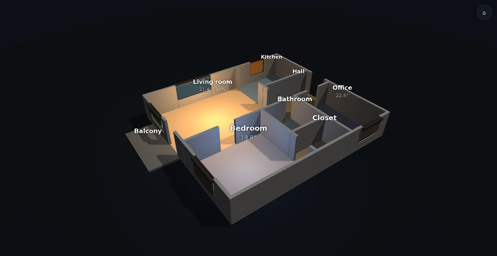

# Floorplan 3D Card

La tua casa in 3D, come card Lovelace per [Home Assistant](https://www.home-assistant.io/), da poche righe di
YAML. Descrivi le stanze e dove sono porte e finestre: i muri li costruisce la card.

- **Dal vivo**: le luci accese illuminano la loro stanza (colore e luminosità), le tapparelle seguono le
  cover, le finestre aperte diventano ambra, ogni stanza mostra temperatura e umidità.
- **Tocchi una stanza**: la camera ci vola dentro, le altre stanze sfumano e un pannello laterale elenca le
  entità dell'**area** di Home Assistant di quella stanza, con le tile native.
- **Tocchi una finestra**: more-info della sua cover (o del sensore di apertura).
- Trascina per ruotare, pizzica o rotella per lo zoom, due dita o tasto destro per spostare.
- Leggera: disegna un fotogramma solo quando cambia qualcosa (nessun loop continuo), rotazione automatica
  spenta di default, nulla viene disegnato se la plancia è in background.
- Nessun build step, nessuna richiesta esterna: Three.js è incluso.

🇬🇧 [Read in English](README.md)



## Installazione
**HACS** (repository personalizzato): HACS → ⋮ → *Repository personalizzati* → URL di questo repo, tipo
*Dashboard* → installa *Floorplan 3D Card* → ricarica il browser.

**A mano**: copia tutta la cartella `dist/` in `/config/www/floorplan-3d-card/`, poi *Impostazioni → Plance →
⋮ → Risorse → Aggiungi*: URL `/local/floorplan-3d-card/floorplan-3d-card.js`, tipo *Modulo JavaScript*.

Aggiungi la card dal selettore (*Floorplan 3D Card*): parte con un appartamento dimostrativo da sostituire
con il tuo.

## Disegnare la casa
Misure in **centimetri**. Scegli un'origine (per esempio l'angolo interno in alto a sinistra):
**x cresce verso destra, y verso il basso**, come su una pianta di carta.

```yaml
type: custom:floorplan-3d-card
rooms:
  - id: soggiorno
    area: soggiorno              # id dell'area di HA → entità del pannello, luci, temperatura
    rect: [0, 0, 520, 420]       # x, y, larghezza, profondità
  - id: cucina
    area: cucina
    rect: [520, 0, 300, 260]
    floor: tile
openings:
  - { type: opening, from: [520, 40], to: [520, 220] }          # cucina a vista: niente muro
  - { type: door, at: [520, 340], width: 90 }                     # un punto sul muro + larghezza
  - { type: window, at: [260, 0], width: 200, cover: cover.soggiorno }
```

Esempio completo in [`examples/demo.yaml`](examples/demo.yaml). Tutte le opzioni sono nelle tabelle del
[README in inglese](README.md#card-options).

Come nascono i muri: ogni lato di stanza diventa un muro; dove due stanze si toccano il lato in comune
diventa **un solo** muro che appartiene a entrambe. Porte, finestre e passaggi vengono ritagliati dal muro su
cui stanno (il punto dell'apertura deve stare su un lato di stanza). Le stanze non devono sovrapporsi.

## Anteprima senza Home Assistant
```bash
python3 -m http.server      # dalla radice del repo
# apri http://localhost:8000/examples/preview.html  (anche ?room=living, ?theme=light, ?rotate=1)
```

## Estendere
La card è una classe estendibile (pannello, popup, oggetti nella scena): vedi
[docs/EXTENDING.md](docs/EXTENDING.md).

## Licenza
MIT — vedi [LICENSE](LICENSE). Include [Three.js](https://threejs.org/) r128 (licenza MIT).
