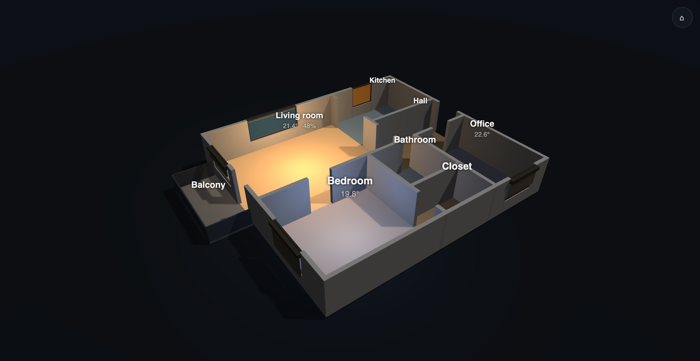
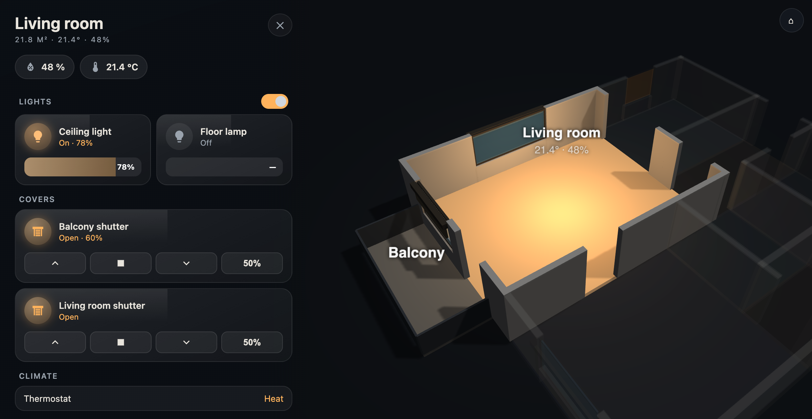

# Floorplan 3D Card

Your home in 3D, as a [Home Assistant](https://www.home-assistant.io/) Lovelace card, from a few lines of YAML.
Describe the rooms and where the doors and windows are; the walls are built for you.

- **Live**: lights glow in their room (colour and brightness), roller shutters follow the covers,
  open windows turn amber, each room shows its temperature and humidity.
- **Tap a room**: the camera flies in, the other rooms fade out, and a side panel shows that room's Home
  Assistant **area**: temperature, humidity and motion as chips, the rest as native tile cards grouped in
  sections (Lights, Covers, Climate…), with one switch for all the lights of the room.
- **Tap a window**: more-info of its cover (or contact sensor).
- Drag to rotate, pinch or scroll to zoom, two fingers or right-drag to pan.
- Light on resources: frames are drawn only when something changes (no render loop), auto-rotation is off
  by default, nothing is drawn while the dashboard is in the background.
- No build step, no external requests: Three.js is bundled.





## Installation
**HACS** (custom repository): HACS → ⋮ → *Custom repositories* → this repository's URL, type *Dashboard* →
install *Floorplan 3D Card* → reload the browser.

**Manual**: copy the whole `dist/` folder to `/config/www/floorplan-3d-card/`, then
*Settings → Dashboards → ⋮ → Resources → Add*: URL `/local/floorplan-3d-card/floorplan-3d-card.js`,
type *JavaScript module*. The other files in `dist/` are loaded from the same folder.

Add the card from the card picker (*Floorplan 3D Card*): it starts with a demo apartment that you then
replace with yours. Tip: a view of type **Panel** with `height: calc(100vh - 56px)` gives a full-screen plan.

## Drawing your home
Measure in **centimetres**. Pick an origin (for example the top-left inside corner of the home):
**x grows to the right, y grows down**, like on a paper plan.

```yaml
type: custom:floorplan-3d-card
rooms:
  - id: living
    area: living_room            # Home Assistant area id → panel entities, lights, temperature
    rect: [0, 0, 520, 420]       # x, y, width, depth
  - id: kitchen
    area: kitchen
    rect: [520, 0, 300, 260]
    floor: tile
  - id: hall
    area: hallway
    points: [[520, 260], [820, 260], [820, 420], [520, 420]]   # any polygon (L shapes, angled walls)
openings:
  - { type: opening, from: [520, 40], to: [520, 220] }          # open kitchen: no wall there
  - { type: door, at: [520, 340], width: 90 }                     # a point on the wall + width
  - { type: window, at: [260, 0], width: 200, cover: cover.living_room }
```

A complete example is in [`examples/demo.yaml`](examples/demo.yaml).

How walls are made: every room edge becomes a wall; where two rooms touch, the shared edge becomes
**one** wall that belongs to both. Doors, windows and openings are cut out of the wall they sit on
(the opening's point must be on a room edge, within a wall thickness). Rooms must not overlap.

### Card options
| Option | Default | Description |
|---|---|---|
| `rooms` | — | List of rooms (required), see below |
| `openings` | `[]` | Doors, windows, open passages |
| `height` | `480px` | Card height (any CSS length: `70vh`, `calc(100vh - 56px)`) |
| `theme` | `auto` | `auto` follows Home Assistant's dark mode, `sun` is dark after sunset (`sun.sun`), or `dark` / `light` |
| `auto_rotate` | `false` | Slow rotation of the overview; pauses for 45 s after you touch it |
| `labels` | `true` | Room names and temperatures floating over the rooms |
| `wall_thickness` | `12` | cm |
| `wall_height` | `130` | Visual height of the walls (they are cut away so you can see inside) |
| `floor_height` | `10` | Visual thickness of the floor |
| `sill` | `45` | Default window sill, on the `wall_height` scale |
| `door_width` / `window_width` | `80` / `120` | Defaults when `width` is omitted |
| `sections` | Lights, Covers, Climate, Media, Vacuum, Other, Sensors | Sections of the room panel: `- { name: Luci, domains: [light] }`. Rename them, reorder them, merge domains; entities of a domain in no section are not shown |

### Room options
| Option | Description |
|---|---|
| `id` | Unique id (defaults to `area`) |
| `rect` **or** `points` | `[x, y, width, depth]` or a polygon `[[x, y], …]` |
| `area` | Home Assistant area id: its entities fill the panel, its lights make the glow, its temperature/humidity sensors make the label |
| `name` | Label (defaults to the area name) |
| `floor` | `wood`, `wood2`, `tile`, `carpet`, `concrete`, `stone`, `dark` or a colour `'#a08060'` |
| `entities` | Explicit panel list (replaces the area's) |
| `exclude_entities` | Entities of the area to leave out |
| `lights` | Lights that make the glow (default: the area's lights) |
| `temperature` / `humidity` | Sensors for the label; `false` shows none. Default: the sensors chosen for the area in Home Assistant (*Settings → Areas*), else the area's first ones |
| `walls: false` | No walls (balcony, terrace, open space shown as a floor) |
| `railing: true` | With `walls: false`: a railing on the edges that do not touch another room |
| `part_of` | Id of another room this one belongs to (a balcony of the living room): a tap opens that room, and this one stays visible with it |
| `label: [x, y]` | Where to put the label, if the automatic spot is not good |
| `disabled: true` | Not clickable |

### Opening options
| Option | Description |
|---|---|
| `type` | `door` (default), `window`, `opening` (a gap with no door, e.g. open kitchen) |
| `at` + `width` **or** `from` + `to` | Centre point on the wall and width, or the two ends |
| `sill` | Windows only: height of the sill on the `wall_height` scale; `0` for a French window |
| `cover` | Cover entity: roller shutter drawn outside, follows `current_position`; tap = more-info |
| `contact` | Binary sensor: glass turns amber when open |
| `shutter: false` | Hide the roller shutter of a window that has a cover |
| `name` | Label used by extensions |

## Preview without Home Assistant
```bash
python3 -m http.server      # from the repo root
# open http://localhost:8000/examples/preview.html  (also ?room=living, ?theme=light, ?rotate=1)
```
A fake Home Assistant feeds the demo apartment; the buttons flip lights, shutters and sensors.

## Roadmap
What is done and what comes next: [ROADMAP.md](ROADMAP.md). Changes of each version: [CHANGELOG.md](CHANGELOG.md).

## Extending
The card is a class you can extend: your own panel, popups, objects in the scene, extra overlays.
See [docs/EXTENDING.md](docs/EXTENDING.md).

## Troubleshooting
- **Error "openings[n] … is not on any room edge"**: the point is not on a wall. Doors between rooms go on
  the shared edge; check the coordinates.
- **Empty panel**: the room has no `area`, or the area has no entities (entities can get their area from
  their device). Use `entities:` to list them by hand.
- **No glow**: the glow comes from the `light.*` entities of the area (or `lights:`).
- **Wrong temperature on a room** (e.g. the oven's): choose the room sensor for the area in Home Assistant
  (*Settings → Areas*), set `temperature:` on the room, or `temperature: false`.
- **Blank card**: the browser has no WebGL (very old tablets). The error is shown at the bottom of the card.

## Development
```bash
node --test tests/                           # geometry tests
for f in dist/floorplan-*.js; do node --check "$f"; done
```

## License
Copyright © 2026 xT4nk. Licensed under the **GNU General Public License v3.0 or later** — see
[LICENSE](LICENSE). You can use, study, change and share the card freely; if you distribute it or a modified
version, you must do so under the same license, with the source code. Versions up to 0.1.0 were released
under the MIT license.

Bundles [Three.js](https://threejs.org/) r128 (`dist/three.module.js`), © 2010-2021 Three.js Authors, under
its own MIT license — see [THIRD_PARTY_NOTICES.md](THIRD_PARTY_NOTICES.md).
